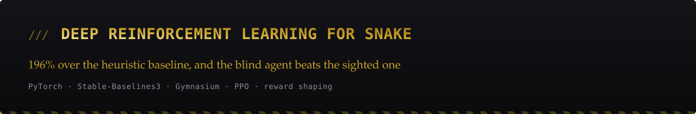
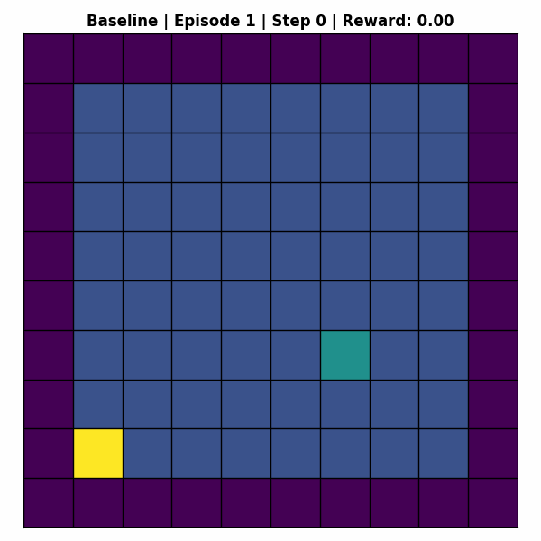
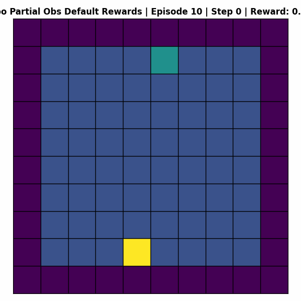
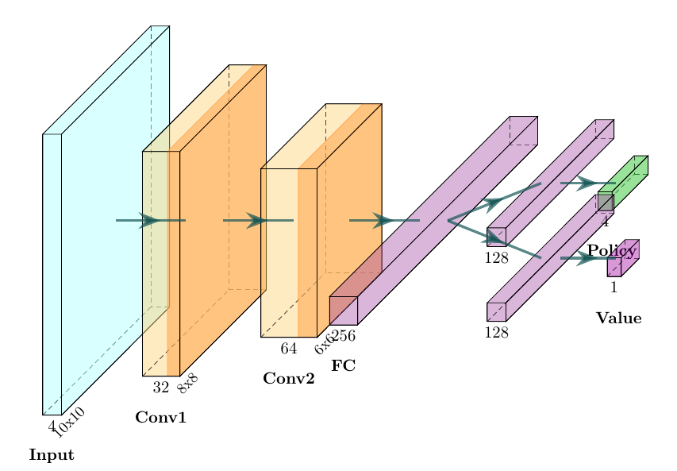
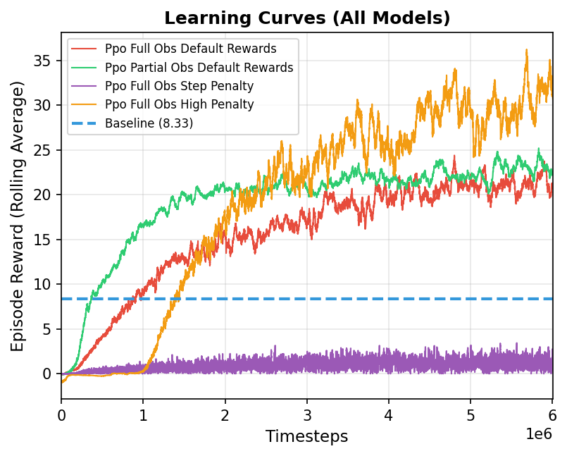
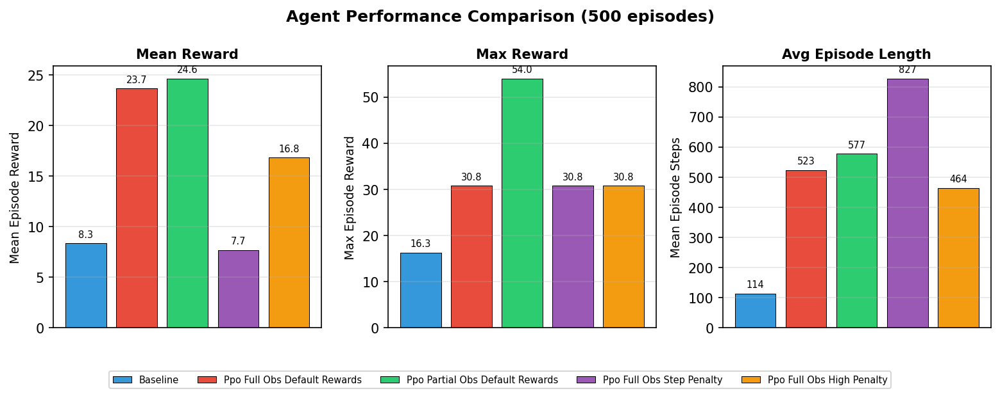
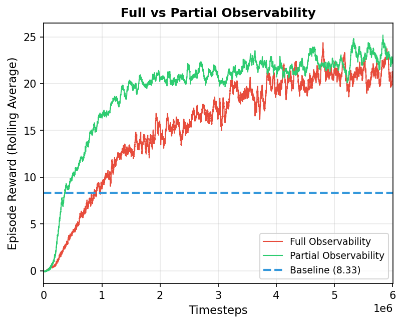

> **The partially observable agent (5x5 local view) beats the fully observable one: 7.2% win rate, 196% improvement in mean episode reward over the heuristic baseline.**


[](report/report.pdf)

<table>
<tr>
<td align="center"><b>Heuristic baseline</b></td>
<td align="center"><b>PPO, partial observability</b></td>
</tr>
<tr>
<td></td>
<td></td>
</tr>
<tr>
<td align="center">Mean reward 8.33, 17.07 fruits, 0.0% wins</td>
<td align="center">Mean reward 24.63, 49.49 fruits, 7.2% wins</td>
</tr>
</table>

## Abstract

I trained a PPO agent to play Snake on a 10x10 board (8x8 playable) with Stable-Baselines3 and a custom CNN feature extractor, and compared it against a greedy heuristic baseline over 500 evaluation episodes. Two experiments sit on top of that comparison: how much of the board the agent is allowed to see (the full board, or a 5x5 window centred on its head), and how the reward function is shaped (default rewards, a per-step penalty of -0.001, high-magnitude rewards). The partially observable agent is the best of the four models on every metric, with a mean episode reward of 24.63 against 23.66 for full observability and 8.33 for the baseline, and it is the only agent that ever completes a board (7.2% win rate against 0.0% for everyone else). The step penalty collapsed the policy into immediate self-termination, and the high-magnitude variant produced the best training curve of all four models while placing third at evaluation.

## Problem

Snake is a finite MDP with deterministic transitions, four discrete actions, and a state that grows its own obstacles. The agent eats fruit, the body lengthens, and cells that were safe two moves ago are now walls of the agent's own making. Three properties make it hard.

**Sparse reward.** The only positive signal arrives at the instant a fruit is eaten. Everything in between (dozens of navigation steps) scores zero under the default reward set, so the return has to travel a long way back to reach the decisions that actually mattered.

**A non-stationary obstacle set.** The board geometry is a function of the agent's own history. A policy that memorised safe regions of the grid would be wrong by construction.

**Self-trapping.** The agent can reach configurations where every action is fatal. Recognising those several moves before they close requires lookahead that a reactive policy does not have. The greedy baseline shows exactly this: it maximises the immediate move toward the fruit, and it walls itself in at around 17 fruits.

Then there is the reward-hacking risk. Any shaping term added to make the agent "more efficient" changes what the optimal policy is, and the arithmetic is easy to get wrong. The step penalty variant is the demonstration. A cost of -0.001 per step, integrated over the 1000-step horizon, is -1.0, which is worth more than two fruit rewards. Under that reward, dying at once is optimal. That is what the agent learned. Over 60% of its evaluation episodes score exactly 0.0, and it finishes 8% below the heuristic baseline.

## Motivation

The questions this project tests are general and they transfer.

Credit assignment over long horizons is the core difficulty of RL, and Snake presents it in a clean form. Episodes run to 1000 steps, the mean length of the winning model's last 100 training episodes was 539, and a single fruit reward has to be spread back across every move that led to it. GAE lambda 0.9 and gamma 0.99 are doing real work here, and the learning curves show it.

The state space is non-stationary in a way that a static grid world is not. The agent is the source of its own distribution shift. A policy that is optimal at body length 5 can be suicidal at length 40, and no amount of training on early-game states fixes the late game.

The observability question is worth asking because the default assumption in practice is that more information is better. Feeding the whole board seems obviously correct. It lost.

## Approach

**Environment.** A custom 10x10 grid including walls, so 8x8 playable. Cells are one-hot encoded over five categories (wall, empty, fruit, body, head). The wall channel is dropped from the observation, since the border is constant and carries no information, which leaves an `(H, W, 4)` tensor. Four discrete actions. Deterministic transitions, gamma 0.99. A Gymnasium wrapper exposes the environment to Stable-Baselines3, and 16 copies run in parallel through `SubprocVecEnv`.

**Observability.** Full observability feeds the whole 10x10 board. Partial observability (mask size 2) feeds only the 5x5 window centred on the head, so `(5, 5, 4)` instead of `(10, 10, 4)`.

**Baseline.** A greedy heuristic. Rank the actions by whether they move toward the fruit, take the first one that is safe, fall back to any safe move. No lookahead.

**Agent.** PPO from Stable-Baselines3 with a custom feature extractor: two 3x3 convolutions, a 256-unit dense layer, then separate 128-unit policy and value heads.

<p align="center">
  
</p>

The extractor, verbatim from `source/train_ppo.py`:

```python
self.conv_layers = torch.nn.Sequential(
    torch.nn.Conv2d(input_channels, 32, kernel_size=3, padding=1),
    torch.nn.ReLU(),
    torch.nn.Conv2d(32, 64, kernel_size=3, padding=1),
    torch.nn.ReLU(),
    torch.nn.Flatten(),
)
```

`padding=1` preserves the spatial resolution, so the same stack takes the 10x10 and the 5x5 observation without a shape change. The flattened size is measured by pushing a dummy tensor through it.

**Rewards.** Three configurations, defined in `REWARD_PRESETS`.

| Event | Default | Step penalty | High penalty |
|---|---|---|---|
| Win | 1.0 | 1.0 | 10.0 |
| Fruit | 0.5 | 0.5 | 1.0 |
| Step | 0.0 | -0.001 | 0.0 |
| Self-collision | -0.2 | -0.2 | -1.0 |
| Wall collision | -0.1 | -0.1 | -1.0 |

**Training.** 6,000,000 timesteps per model, 16 parallel environments, learning rate 3e-4, GAE lambda 0.9, clip range 0.2, entropy coefficient 0.01, value coefficient 0.5, batch size 2048, 15 epochs per batch, 1024 steps per rollout, seed 0.

**Evaluation.** 500 episodes per agent, seed 0, episode ends on collision or at 1000 steps. Every agent is scored under the default rewards whatever it trained on, so the numbers compare.

## Results

Evaluation over 500 episodes, default rewards for all agents.

| Agent | Mean reward | Mean fruits | Win rate | vs baseline |
|---|---|---|---|---|
| Baseline (greedy heuristic) | 8.33 ± 2.43 | 17.07 ± 4.87 | 0.0% | n/a |
| PPO, full obs, default rewards | 23.66 ± 9.09 | 47.70 ± 18.22 | 0.0% | +184% |
| **PPO, partial obs, default rewards** | **24.63 ± 7.16** | **49.49 ± 14.02** | **7.2%** | **+196%** |
| PPO, full obs, step penalty | 7.67 ± 12.07 | 15.47 ± 24.32 | 0.0% | -8% |
| PPO, full obs, high penalty | 16.81 ± 9.04 | 33.98 ± 18.14 | 0.0% | +102% |

Training reward against evaluation reward:

| Model | Training | Evaluation |
|---|---|---|
| Full obs | 21.23 | 23.66 |
| Partial obs | 22.39 | 24.63 |
| High penalty | 30.70 | 16.81 |
| Step penalty | 0.46 | 7.67 |

<p align="center">
  
</p>

*100-episode rolling average of episode reward over 6M training steps, with the baseline mean of 8.33 for reference. The high penalty model climbs highest in training and does not carry it to evaluation. The step penalty model never leaves the floor.*

<p align="center">
  
</p>

*Mean reward, maximum reward and episode length across the five agents. The step penalty variant carries the widest spread of any model, standard deviation 12.07 on a mean of 7.67.*

<p align="center">
  
</p>

*Partial observability (green) crosses the baseline within roughly 300k steps and stays ahead of full observability (red) for the whole 6M-step run.*

## Discussion

Restricting the observation improved the policy. That is the finding I did not expect, and the explanation is plain: a smaller observation space generalises better. The 5x5 window is 25 cells against 100, so the CNN sees a quarter of the input and the policy has far fewer distinct states to fit. Inside a fixed 6M-step budget, that buys a better policy and it converges sooner, which is visible in the first million steps of the observability figure. The window also drops cells that have no bearing on the next action, the same reasoning that removed the wall channel. The cost is real. A 5x5 view cannot see a fruit on the far side of the board and it cannot see a trap forming three cells beyond its horizon. The local agent won anyway: 24.63 against 23.66 in mean reward, lower variance, higher maximum, and the only non-zero win rate in the set.

The second finding is about evaluation protocol, and it is the one I would carry into any project. The high penalty model had the best training curve of all four, reaching 30.70 mean training reward against 22.39 for the eventual winner. At evaluation it scored 16.81, a drop of 45.2%, which put it third. Training reward does not predict evaluation reward. The 10.0 win and 1.0 fruit rewards inflate the training average by construction, while the -1.0 collision penalties push the policy toward a caution that costs it fruit once it is scored on the default scale. A held-out evaluation under a common reward function is the only thing that exposes this. Ranking by training curve would have shipped the wrong model.

The step penalty is the third lesson and it is arithmetic. A shaping term has to be checked against its integral over an episode, not judged per step. -0.001 reads as harmless. Multiplied by 1000 steps it is worth two fruits, and it flips the sign of the optimal policy.

## Limitations

7.2% is a low win rate in absolute terms. The best agent finishes the board in fewer than one episode in thirteen, and the other four agents never finish it at all.

No long-horizon planning exists anywhere in this system. PPO over a two-layer CNN is a reactive policy. It maps the current observation to an action distribution and has no model of the board, no search, and no explicit representation of the region it is about to seal off. A Hamiltonian-cycle prior or a lookahead search would very likely beat it on win rate.

The agent still self-traps. That is what ends most of its episodes and it is the direct cause of the win-rate ceiling. The 5x5 view makes it worse in principle, because a trap forming outside the window is invisible until the agent is already inside it.

Smaller gaps, worth stating: one seed per configuration (seed 0), so the gap between full and partial observability has no across-run variance estimate behind it; a single 10x10 board, so nothing here says how the result scales; and no action masking, so part of every rollout is spent on moves that are invalid by construction.

## Reproduce

**The trained weights ship in `weights/`.** `evaluate.py` runs against them directly, so nothing has to be retrained.

```bash
pip install tensorflow matplotlib "stable-baselines3[extra]"
python evaluate.py
```

Developed on Python 3.11.14. `evaluate.py` discovers every `.zip` in `weights/`, reads the matching `_metadata.json` to recover the observability mode, and scores each model alongside the greedy baseline.

Neither script takes command line flags. Settings are module-level constants at the top of each file. The ones that matter in `evaluate.py` are `N_EPISODES` (100 by default, the report used 500), `BOARD_SIZE`, `MAX_STEPS`, `SEED`, and `EXPORT_FOR_FIGURES` (set it to `True` to write the metrics JSON and regenerate the figures).

To retrain:

```bash
python train.py
```

`train.py` is an interactive menu. It offers the best model alone (partial observability, default rewards) or all four report models in sequence, and it asks for the timestep budget, default 6,000,000. Checkpoints are written every 200,000 steps. Final weights, metadata and metrics land in `weights/`. Cost per model: 6M timesteps across 16 parallel environments.

## Report, data and citation

The full write-up, with the MDP formulation, the PPO objective, the ablations and the reference list: [`report/report.pdf`](report/report.pdf).

There is no external dataset. The Snake environment is implemented from scratch in `source/environments.py`, and every episode used for training and evaluation was generated by it.

Licensed MIT. See [`LICENSE`](LICENSE).

```bibtex
@software{mihailescu_deep_rl_snake,
  author = {Alexandru Mihailescu},
  title  = {Deep Reinforcement Learning for Snake},
  url    = {https://github.com/artaeun/deep-rl-snake}
}

@article{schulman2017ppo,
  author  = {John Schulman and Filip Wolski and Prafulla Dhariwal and Alec Radford and Oleg Klimov},
  title   = {Proximal Policy Optimization Algorithms},
  journal = {arXiv preprint arXiv:1707.06347},
  year    = {2017}
}

@article{raffin2021sb3,
  author  = {Antonin Raffin and Ashley Hill and Adam Gleave and Anssi Kanervisto and Maximilian Ernestus and Noah Dormann},
  title   = {Stable-Baselines3: Reliable Reinforcement Learning Implementations},
  journal = {Journal of Machine Learning Research},
  year    = {2021}
}
```
